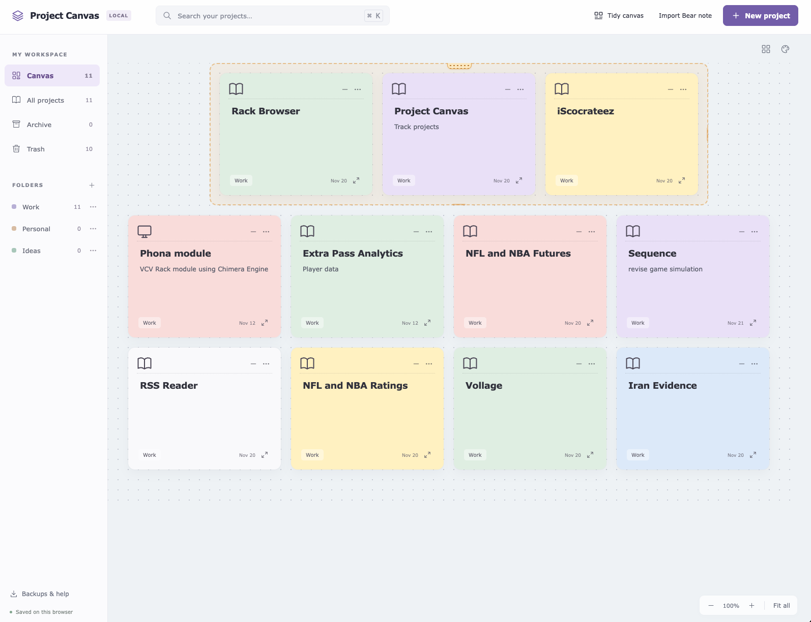

# Project Canvas

A small, private board for the projects you are working on. Each project is a card with a rich-text note behind it. Arrange the cards on a free canvas, keep the ones you are working on right now in a highlighted zone, and import notes from Bear.

**Live app:** https://millxing.github.io/project-canvas/



Everything runs in your browser. There is no account, no server and no cloud sync. Your projects stay on your computer.

## What it does

- **Free canvas.** Drag a card by its header, resize it from the bottom-right corner, minimize it, or switch to a tidy grid layout. Cards snap to a 20px grid.
- **Hot zone.** The amber box marks the projects you are working on now. Drag cards into it. It grows and shrinks to fit them. Move it with the tab on its top edge. Resize it with the thin handles on its bottom and right edges. In grid layout, use a card's menu: **Add to hot zone**.
- **Notes.** Headings, bold, italic, lists, checklists, links, images and YouTube embeds.
- **Organize.** Folders, search (Cmd/Ctrl K), Archive, and Trash with restore.
- **Bear import.** Drag a note from Bear onto **Import Bear note**. Formatting and images come across as an independent copy. Your Bear original is not changed.
- **Backups.** Export everything to one JSON file. Importing a backup replaces what is on your canvas, after a confirmation.

## Use it

**Online:** open the live app above.

**On your computer:** double-click `Start Project Canvas.command` (needs Python 3). It serves the app at `http://127.0.0.1:4173` and opens your browser. You can also open `index.html` directly, but YouTube embeds need the local address.

Your data is stored in the browser, per address. The live site, `127.0.0.1:4173` and a `file://` copy each keep their own projects. To move projects between them, use **Backups & help → Export backup**, then **Import backup**. Clearing your browser's site data deletes your projects, so export a backup now and then.

For the full guide, see [`help.html`](help.html) (also reachable in the app from **Backups & help → How this works**).

## Keyboard

| Key | Action |
| --- | --- |
| Tab, then Enter | Open the focused card |
| Arrow keys | Move the focused card one grid step |
| Shift + arrow keys | Resize the focused card |
| Cmd/Ctrl K | Search |
| Esc | Close the editor or a menu |

## Develop

Plain HTML, CSS and JavaScript. There is no build step. Libraries are in `vendor/`.

```sh
for t in tests/*.cjs; do node "$t"; done
```

GitHub Pages serves the repository root from `main`. Pushing to `main` updates the live site in about a minute.
